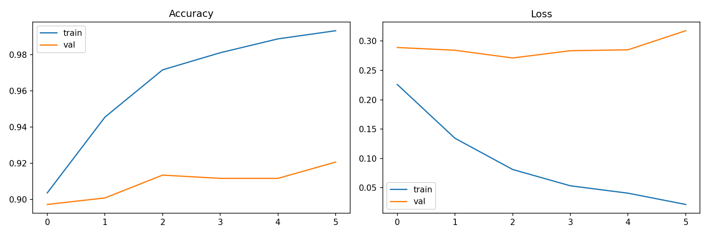
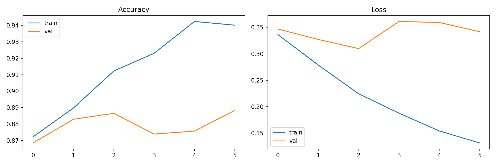
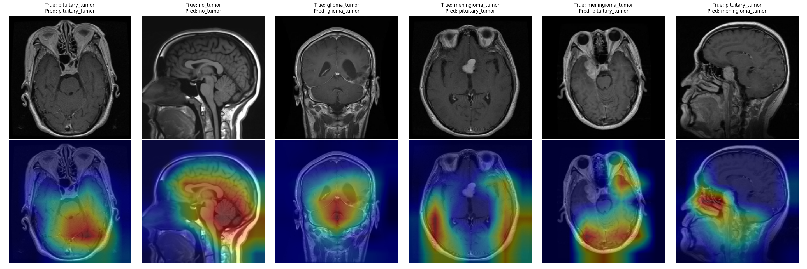

# Brain Tumor MRI Classification (Educational Project)

> **Disclaimer:** This is a learning project. It is **not a medical device** and must **not** be used for diagnosis or any clinical decision. Please do not upload real patient scans to the demo.

A 4-class brain MRI classifier (glioma, meningioma, pituitary tumor, no tumor) built with transfer learning (ResNet50). The main finding of this project is not the accuracy number but **how much the number depended on how the data was split and cleaned**.

## Key findings

- **22% of the official test images were exact duplicates of training images** (88 of 394), and **93 duplicate files existed inside the training set**. I removed them before evaluating.
- Fine-tuning ResNet50 reached **92% validation accuracy**, but on the **clean held-out test set it reached only 68%**, with glioma recall dropping from 95% to 26%.
- **Grad-CAM** showed that, in the misclassified examples I inspected, the model often attended to skull borders, orbits or nasal regions instead of the lesion.
- Together, this suggests the validation score was optimistic (likely because near-duplicate slices from the same patients ended up in both train and validation) and the model is **not reliable** for clinical use.

## Dataset

- Kaggle: *Brain Tumor Classification (MRI)* (`sartajbhuvaji/brain-tumor-classification-mri`). Please check the dataset page for authors and licence.
- Original split: **2,870 training** images (826 glioma, 822 meningioma, 395 no tumor, 827 pituitary) and **394 testing** images.

### Data cleaning

1. Computed an **MD5 hash** of every image file to find exact copies.
2. Removed the **88 test images** that were exact copies of training images, leaving a **clean test set of 306 images** (glioma 100, meningioma 115, no tumor 17, pituitary 74).
3. Removed the **93 duplicate files inside the training folder**, leaving **2,777 images**.
4. Split the cleaned training data **80/20** into **2,222 train / 555 validation** images (fixed seed).
5. The test set was used **once**, at the very end, with the final model only.

> Note: MD5 only catches byte-identical files. Near-duplicates (neighbouring slices of the same patient, resized copies) are **not** detected.

## Method

- **Input:** 224 x 224 RGB, ResNet50 `preprocess_input` applied inside the model.
- **Model:** ImageNet-pretrained ResNet50 (no top) + GlobalAveragePooling + Dropout(0.3) + Dense(4, softmax).
- **Loss / optimiser:** categorical cross-entropy, Adam; **class weights** to handle the smaller `no_tumor` class; early stopping on validation loss (best weights restored).
- **Three experiments:**
  1. **Frozen baseline:** train only the new head (lr 1e-3).
  2. **Fine-tuning (final model):** unfreeze the last 30 layers of ResNet50 (BatchNorm layers kept frozen), lr 1e-5.
  3. **Fine-tuning + augmentation:** horizontal flip, rotation (0.05), zoom (0.1).

## Results

### Validation set (555 images)

| Model | Accuracy | Glioma recall | Meningioma recall | No tumor recall | Pituitary recall | Tumor predicted as "no tumor" (of 484) |
|---|---|---|---|---|---|---|
| ResNet50 frozen | 0.88 | 0.91 | 0.79 | 0.94 | 0.92 | 12 |
| **ResNet50 fine-tuned (final)** | **0.92** | 0.95 | 0.84 | 0.94 | 0.95 | **1** |
| Fine-tuned + augmentation | 0.90 | 0.95 | 0.79 | 0.96 | 0.96 | 3 |

Augmentation gave no measurable benefit in this setup (the difference is about 6 images out of 555, within normal run-to-run noise), so I kept the simpler model.

| Training curves (fine-tuned) | Training curves (with augmentation) |
|---|---|
|  |  |

Training accuracy kept rising while validation loss stayed flat, which is a sign of overfitting. Early stopping restored the best epoch.

### Clean test set (306 images, final model, evaluated once)

| Class | Precision | Recall | F1 | Support |
|---|---|---|---|---|
| Glioma | 0.96 | **0.26** | 0.41 | 100 |
| Meningioma | 0.63 | 0.97 | 0.76 | 115 |
| No tumor | 0.37 | 1.00 | 0.54 | 17 |
| Pituitary | 0.98 | 0.72 | 0.83 | 74 |
| **Accuracy** | | | **0.68** | 306 |
| Macro average | 0.73 | 0.74 | 0.63 | 306 |

Test confusion matrix (rows = true class, columns = predicted class):

| | Glioma | Meningioma | No tumor | Pituitary |
|---|---|---|---|---|
| **Glioma** | 26 | 53 | 20 | 1 |
| **Meningioma** | 1 | 112 | 2 | 0 |
| **No tumor** | 0 | 0 | 17 | 0 |
| **Pituitary** | 0 | 14 | 7 | 53 |

- On the test set, **29 of 289 tumor images (10%) were predicted as "no tumor"**, versus 1 of 484 on validation.
- The model leans towards predicting **meningioma**: 53 of 100 gliomas were predicted as meningioma.
- The no-tumor class has only 17 test images, so its recall (1.00) is not reliable.
- The class mix differs between validation and test, so compare per-class recall rather than overall accuracy.

| Validation | Clean test |
|---|---|
|  |  |

## Grad-CAM

Grad-CAM on six validation images (three correct, three wrong). In all three misclassified cases the heatmap fell on skull borders, orbits or the nasal region rather than on the visible lesion.



Six images is a small sample, and Grad-CAM on ResNet50's last layer is coarse (7 x 7 feature map), so this is an indication, not proof.

## Limitations

- **Validation was split randomly** from the training data, and the dataset has no patient IDs, so near-duplicate slices from the same patient may appear in both train and validation. This probably inflated the 92%.
- The **clean test set is small** (306 images) and the `no_tumor` class has only 17 test images.
- Images come from **one public dataset**; there is no external validation.
- Grad-CAM suggests the model may rely on **non-tumor cues**, such as scan orientation or head position (a hypothesis, not tested).
- Exact-duplicate detection does not catch near-duplicates.
- **Not clinically reliable.** Educational use only.

## Future work

- Patient-level (group) splitting, if patient IDs are available, and an external test dataset
- Crop the brain region and normalise intensity
- Stronger augmentation and longer training, evaluated on a leakage-free split
- Test other backbones (e.g. EfficientNet) and compare on the clean test set
- Model calibration and uncertainty estimates

## Demo

<!-- TODO: add the live Streamlit link here once deployed. If deployment is not possible, delete this section and add screenshots in assets/ instead. -->
**Live demo:** TODO

The app takes an uploaded MRI image, shows the predicted class with per-class probabilities, and displays the limitations above.

## How to run

```bash
git clone https://github.com/<GITHUB_USERNAME>/brain-tumor-mri-classifier.git
cd brain-tumor-mri-classifier
pip install -r requirements.txt
streamlit run app.py
```

The app downloads the trained model from Hugging Face on first launch:
`https://huggingface.co/<HF_USERNAME>/brain-mri-resnet50`

Tested with TensorFlow 2.21.0 and Keras 3.13.2.

## Repository structure

```
brain-tumor-mri-classifier/
├── app.py                 # Streamlit demo
├── requirements.txt
├── README.md
├── notebooks/
│   └── brain_mri.ipynb    # data cleaning, training, evaluation, Grad-CAM
└── assets/                # figures used in this README
```

## Tech stack

Python, TensorFlow/Keras (ResNet50), scikit-learn, Matplotlib, Streamlit, Hugging Face Hub, Google Colab (T4 GPU).
